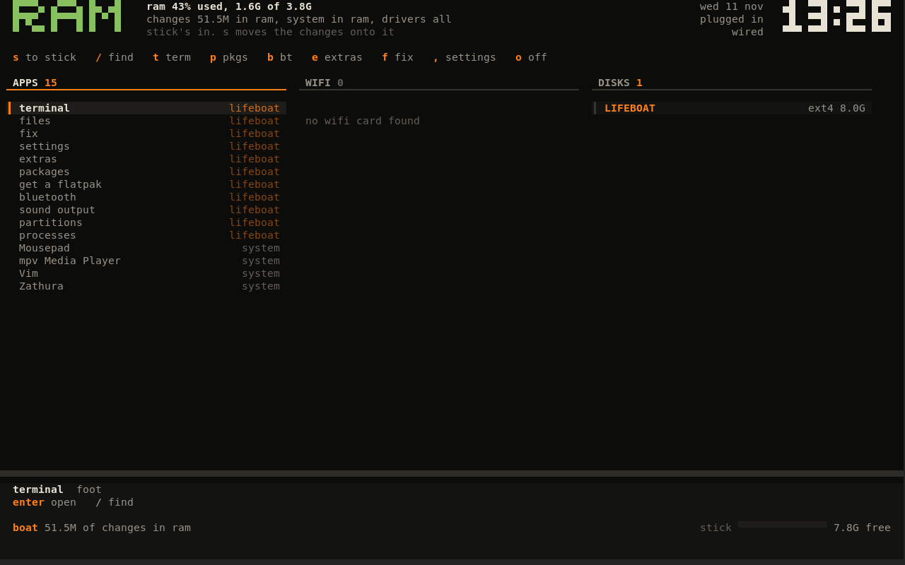
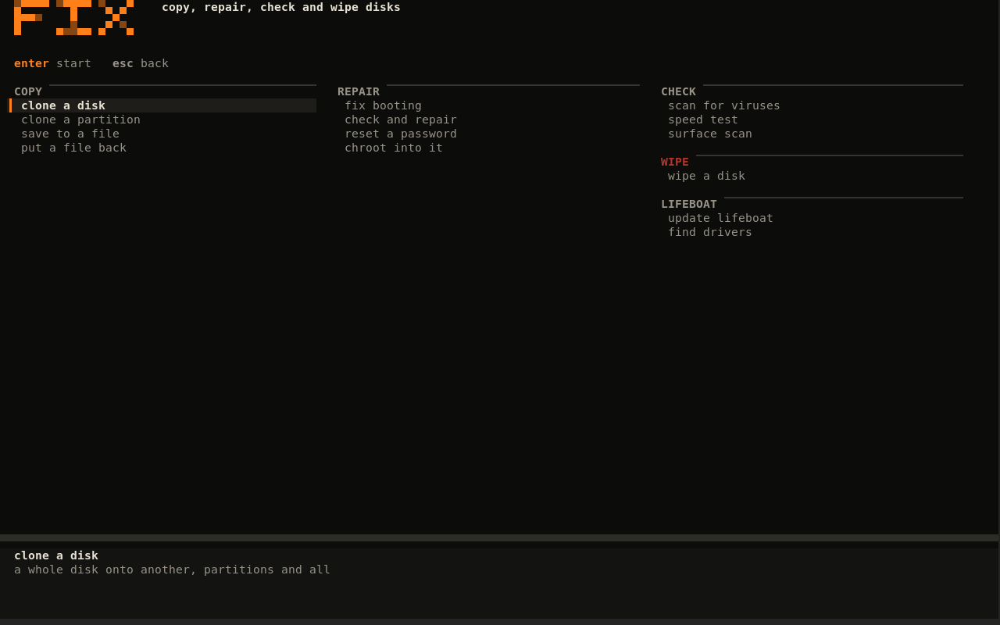
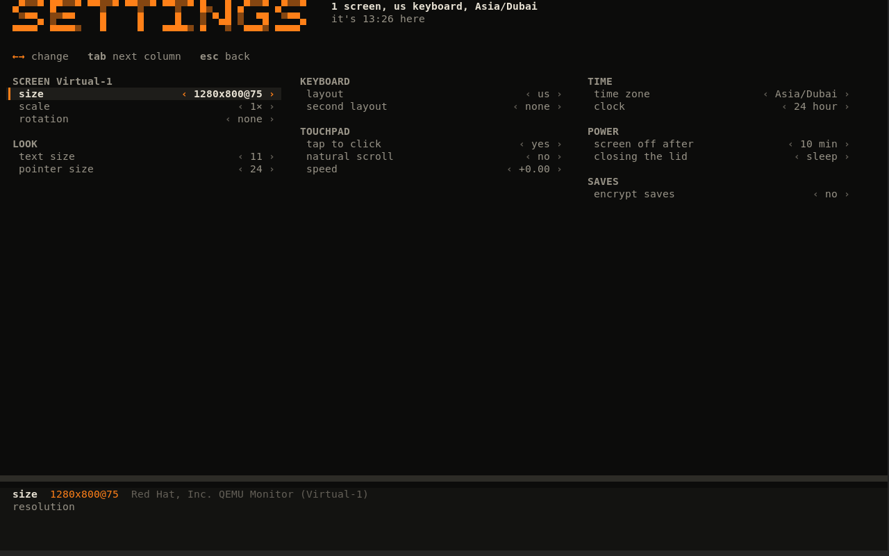

# lifeboat

A small Arch-based Linux that boots from a USB stick and runs from RAM. Use it
when the main disk dies: as a rescue kit, or as a stopgap daily driver until
the machine is fixed.

- The whole system loads into RAM, so the stick can usually come out a minute
  after boot.
- Your changes stay in compressed RAM. When RAM gets tight they move onto the
  stick while everything keeps running.
- At power off you pick: save the session to the stick, or drop it.
- Saves can be encrypted with a passphrase you type at boot.
- The desktop is one terminal program written in C. GUI apps, Flatpaks and
  AppImages still run on top of it.



## Logins

| user | password | |
|---|---|---|
| `lifeboat` | `user` | the desktop user, in `wheel` |
| `root` | `root1234` | |

The home screen's own root jobs (mounting, disk tools, packages, saving) go
through `doas` rules that don't ask for a password. `sudo` and `doas` typed
in a terminal ask for `user`.

Change both if the stick leaves your hands: `passwd` and `doas passwd`.

## Getting it onto a stick

Get `lifeboat.iso`, then either:

- **Flash it** with `dd`, Etcher or Rufus (DD mode). Format the stick later to
  use it as a normal stick again.
- **Copy it** with Rufus in ISO mode, or copy the files onto any FAT32 stick.
  The stick stays a normal stick with a `lifeboat` folder on it.

Boot it through UEFI with Secure Boot off. BIOS boot is not supported.

The iso on its own keeps nothing. To keep sessions, open DISKS, pick the
stick, press `d`, then `9` (or run `doas lifeboat persist /dev/sdX`). That adds
a save partition in the free space of a flashed stick, or a `save.img` on a
FAT32 stick. Nothing is deleted.

## Using it

```
super+space    back to the home screen
super+enter    terminal
super+q        close a window
alt+tab        switch windows
```

The home screen has three columns, APPS, WIFI and DISKS. Arrows move, `enter`
opens, `/` filters.

| key | |
|---|---|
| `s` | move the changes to the stick, or back into RAM |
| `c` | cancel a move halfway, nothing is lost |
| `p` | packages from the repos and the AUR |
| `e` | extras, a checklist of common apps |
| `f` | disk tools |
| `,` | settings |
| `b` | bluetooth |
| `a` | sound output |
| `d` | rescue tools for the selected disk |
| `-` `=`, `[` `]`, `m` | volume, brightness, mute |
| `o` | power off |

The big word in the corner says where the session lives: `RAM`, `STICK`,
`MOVE`, `FULL` (RAM is tight and there's no stick) or `LOST` (the stick was
pulled while the session was on it).



### Disk tools

| | |
|---|---|
| copy | clone a disk or partition (used space with partclone, or every byte with ddrescue), save a disk to an image file, put an image back |
| repair | reinstall a Linux boot loader or the Windows boot entry, fsck, reset a password, chroot |
| check | virus scan (ClamAV, downloaded when needed), speed test, surface scan |
| wipe | quick (signatures and discard), the drive's own secure erase, or zeros |
| lifeboat | update the stick from a newer iso, a link, or the latest GitLab release, find drivers |

Anything that overwrites a disk makes you type its name first.

**Update lifeboat** takes a newer ISO you already have, a link you type, or
`latest from gitlab`, which downloads the newest release straight from GitLab.
The new files are used on the next boot; saved sessions and added packages
carry over.

**Find drivers** loads a driver for every device, restarts sound if a card
showed up late, offers to restart the desktop if the graphics driver did, and
writes `lifeboat-drivers.txt` to your home folder and the save stick. If
something on your machine doesn't work, that file says why.

### Settings

Screen size and refresh rate, scale, rotation, text and pointer size, two
keyboard layouts (alt+shift switches), touchpad, time zone, 12/24 hour clock,
screen off timer, lid action, encrypted saves.



### Command line

```
lifeboat status
lifeboat drivers
doas lifeboat spill | unspill | cancel
doas lifeboat off save|drop [reboot]
doas lifeboat mount /dev/sdb2 [rw]
doas lifeboat chroot /dev/nvme0n1p2 [passwd]
doas lifeboat fixboot /dev/nvme0n1p2
doas lifeboat clone /dev/sda /dev/sdb [used|all]
doas lifeboat image /dev/sda /mnt/sdb1/sda.img
doas lifeboat restore /mnt/sdb1/sda.img /dev/sda
doas lifeboat scan /dev/sdb2
doas lifeboat bench /dev/sdb
doas lifeboat surface /dev/sdb
doas lifeboat wipe /dev/sdb quick|secure|zeros
doas lifeboat update lifeboat.iso
doas lifeboat update gitlab
doas lifeboat persist /dev/sdX
```

A plain `poweroff` or `reboot` keeps what is already on the stick and saves
nothing new.

Boot options: `lifeboat.fresh` ignores the saved session (also in the boot
menu), `lifeboat.shell` stops in the initramfs, `lifeboat.nosplash` skips the
boot animation.

## How it works

The root is an overlay. The lower layer is the system image (squashfs). The
upper layer is an XFS on a device-mapper device, `lifeboat-changes`, which
points at zram or at `changes.img` on the stick.

Moving the changes reloads `lifeboat-changes` as a dm-clone from one to the
other while the filesystem stays mounted. Free space is trimmed first, so only
used blocks get copied. Cancelling clones it back the other way. With
encryption on, `changes.img` is a LUKS2 container.

The image is split into `system.sfs` (~575 MB) and `hw.sfs` (firmware and
modules, ~580 MB). At boot they go into RAM if there's room:

| free RAM | system | drivers |
|---|---|---|
| more than 2.5 × both | RAM | RAM |
| more than 2 × system | RAM | stick |
| less | stick | stick |

After boot only the drivers this machine loaded are kept in RAM. When RAM runs
low things go back to the stick in this order: unused drivers, the system
image, then the changes. They come back when there's room again.

There is no systemd as PID 1. Busybox init runs `rcS`, which starts udevd,
dbus, seatd, iwd, dhcpcd, bluetoothd, acpid, chronyd and the `lifeboat`
watcher. The session is labwc with foot.

## Building

On Arch, with `base-devel`, `arch-install-scripts`, `squashfs-tools`, `cpio`,
`gptfdisk`, `dosfstools`, `mtools`, `libisoburn`, and `qemu-desktop` for
testing. Root is asked for through `pkexec`, only for pacstrap and for writing
a stick.

```
./build.sh tool            compile boat/ into out/lifeboat
./build.sh rootfs          pacstrap, then squash out/system.sfs and out/hw.sfs
./build.sh image           out/initramfs.img (and out/system.img for qemu)
./build.sh all             the three above
./build.sh iso             out/lifeboat.iso
./build.sh usb /dev/sdX    write a stick with a save partition
./build.sh qemu            boot in qemu with a fake stick
./build.sh qemu iso        boot the iso
./build.sh kernel          optional, build our own kernel instead of the host's
```

The image uses the newest Arch kernel installed on the build machine, and
copies its `yay`.

`LIFEBOAT_DEMO=ram boat/lifeboat` shows the home screen without booting
anything (also `stick`, `move`, `full`).

### Layout

```
build.sh            entry point
boat/               the lifeboat binary
  main.c              command line
  store.c             moving changes, saving, power off, the watcher, mounts, chroot
  ram.c               what lives in RAM
  home.c              home screen, rescue drawer, sheets, alerts
  fix.c tools.c       disk tools
  surface.c           surface scan
  drivers.c           find drivers
  pkgs.c              packages (libalpm and yay)
  extras.c            extras checklist
  settings.c          settings
  probe.c             apps, wifi, bluetooth, disks, battery
  splash.c            boot and shutdown animation
  wins.c              open windows (wlr-foreign-toplevel)
  ui.c                drawing, pixel font, input
initramfs/init      first thing that runs
rootfs/             files copied into the image, and packages.list
tools/              rootfs, initramfs, iso, stick and qemu scripts
kernel/             config for ./build.sh kernel
```

## Known limits

- Mostly tested in QEMU. Real hardware has seen little use so far.
- Secure Boot must be off.
- Pulling the stick while the session lives on it loses the session.
- Installing a package on an image that is weeks old is a partial upgrade.
  If something breaks, update everything (`u` on the package page).
- AUR packages that compile need `base-devel` installed first.
